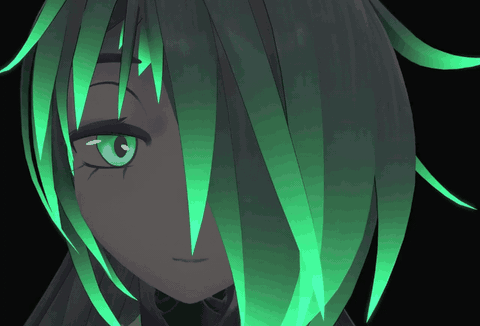

# MouthLink — кастомный трекинг рта для PICO 4 Pro

[English](README.md) | **Русский**

<p align="center"></p>
<p align="center"><a href="docs/media/mouthlink-demo.mp4">Видео (MP4)</a></p>

Свой трекинг рта для PICO 4 Pro. Кадры камеры рта уходят со шлема на ПК, там своя
модель считает блендшейпы и отдаёт их в VRChat через VRCFaceTracking. Цель — то, чего
сток не умеет: калибровка под своё лицо и каналы, которых в стоке нет совсем, в первую
очередь **направление языка** (влево / вправо / вверх / вниз, позже — по кругу). Сток
PICO по языку выдаёт только одно число `TongueOut`.

Глаза остаются на стоковом пути (PicoET-Enhance → PicoFacialBridge → UnifiedPicoModule):
90 Гц, реальные зрачки, независимые глаза. Своим делаем только рот.

## Как устроено

```
   ШЛЕМ (PICO 4 Pro, рут)                            ПК
 ┌───────────────────────────────────┐   ┌───────────────────────────────────┐
 │ pxreyetrackingservice             │   │ MouthLink.Receiver                │
 │  └ PicoET-Enhance-MouthLink       │   │   сборка, статистика, просмотр,   │
 │     ├ кадр камеры рта ────────────┼──▶│   запись .mlrec,                  │
 │     │  (400×400 GRAY8, 90 Гц)     │UDP│   метки стока (.stock.csv),       │
 │     └ стоковые значения рта ──────┼──▶│   голосовые подсказки (.prompts)  │
 │        (та же метка времени)      │   │        │                          │
 └───────────────────────────────────┘   │        ▼                          │
                                         │ tools/mlrec_pair.py → датасет     │
                                         │ training/ → модель (ONNX)         │
                                         │        │                          │
                                         │        ▼                          │
                                         │ UnifiedPicoModule-MouthLink       │
                                         │ (VRCFT: камера → модель → VRChat) │
                                         └───────────────────────────────────┘
```

- **Сторона шлема** — форк *PicoET-Enhance-MouthLink* проекта
  [PicoET-Enhance](https://github.com/WolalaQAQ/PicoET-Enhance) (ветка `mouthlink`).
  Захват идёт внутри payload, который PicoET и так внедряет (без второй инъекции и
  лишнего клиента камеры). Включается явно (`picoet.sh mouthlink-on`), до подписки ПК
  ничего не шлёт. На каждый кадр рта может слать и стоковые значения с **той же меткой
  времени** — кадры и метки спариваются точно.
- **Сторона ПК** — этот репозиторий: протокол, приёмник, запись и просмотр, разметка,
  сборка датасета и обучение.

## Проверено на железе (PICO 4 Pro, PICO OS 5.13.3S)

- Камера рта: **400×400, 8 бит, ИК, 90 кадров/с**; полный поток ≈118 Мбит/с без сжатия,
  задержка ~20 мс, практически без потерь рядом с Virtual Desktop; стоковый трекинг
  глаз и рта остаётся на 90/90 Гц.
- Метки стока: 100 % кадров спарены со стоковыми значениями во всех сессиях.
- Дистилляция стока: 8 сессий (≈44 тыс. кадров 160×160), MobileNetV3-small, проверка на
  посадках, которых модель не видела (по сессиям): **средний MAE 0.034**, худшая сессия 0.049.
- Камера рта смотрит на лицо **сбоку**, поэтому отражение кадра в аугментациях выключено.

## Состав

| Путь | Что это |
|------|---------|
| `PROTOCOL.md` | Протокол: UDP-фрагменты с CRC32, SUBSCRIBE (fps, ROI, флаги), PING/PONG для часов, DISCOVER/HELLO, метки STOCK |
| `MouthLink.Core` | Кадрирование, сборка, сессии `.mlrec`, пакет STOCK и CSV-журнал |
| `MouthLink.Receiver` | Подписка, статистика, запись, просмотр в браузере, ROI, запись стока, калибровка с голосовыми подсказками |
| `MouthLink.Emulator` | Синтетический источник кадров для работы без шлема (без ROI/STOCK) |
| `MouthLink.Player` | Офлайн-плеер `.mlrec` в браузере |
| `tools/mlrec_check.py` | Проверка записи: частота, пропуски, застывшие/чёрные/пересвеченные кадры |
| `tools/mlrec2png.py` | Выгрузка записи в PNG |
| `tools/mlrec_pair.py` | Кадры + сток (+ подсказки) → датасет для обучения |
| `tools/mlrec_eval.py` | Проверка модели по позам на записи с подсказками |
| `tools/mlk_pattern.py` | Шлёт в модуль VRCFT заданные позы языка — проверка аватара без модели |
| `training/` | Обучение на PyTorch (tiny CNN / MobileNetV3), маскированный лосс для частичных меток, проверка по сессиям, экспорт ONNX |

Сборка: .NET 8 SDK (`dotnet build` в корне решения). Для инструментов — Python 3 с NumPy;
для обучения — PyTorch (и Pillow для масштабирования).

## Работа со шлемом

Нужно: PICO 4 Pro с рутом и модулем PicoET-Enhance-MouthLink (ml3 или новее) в режиме
`dual` с `mouthlink-on`; запущенный PicoFacialBridge и **запущенный VRCFaceTracking с
UnifiedPicoModule** (бридж включает трекинг — а значит и камеры — только при подключённом
клиенте на ПК).

**Запись сессии** (все кадры камеры + метки стока):
```
dotnet run --project MouthLink.Receiver -- --host <IP-шлема> --fps 0 --record d:\mouthrecon\s01.mlrec
```
Просмотр: `http://localhost:8080/`. `--fps 0` — каждый кадр камеры (90 кадров/с);
`--roi x,y,w,h` — шлем шлёт только прямоугольник; `--no-stock` — без меток. Ctrl+C
останавливает аккуратно. Между сессиями снимай шлем: каждая запись — одна посадка, и
модель проверяется на посадках, которых не видела.

**Калибровка языка с голосовыми подсказками:**
```
dotnet run --project MouthLink.Receiver -- --host <IP-шлема> --fps 0 --record d:\mouthrecon\t01.mlrec --prompts tongue
```
Приёмник говорит «язык влево / вправо / вверх / вниз / прямо» (русским голосом, если он
есть в Windows, иначе по-английски; `--voice en|off`), 3 круга в случайном порядке по
4 с, ≈2 мин, и останавливается сам. Влево и вправо — в **свою** сторону.

**Калибровка всего лица (все выражения):**
```
dotnet run --project MouthLink.Receiver -- --host <IP-шлема> --fps 0 --record d:\mouthrecon\f01.mlrec --prompts face
```
78 подсказок из `prompts/face.json` в 10 группах — челюсть, губы, уголки рта, нос, щёки,
язык, язык при широко открытом / почти закрытом рте (`tongue_jaw`), открытый рот с языком
внутри (`mouth_open`, учит «языка нет»), эмоции, речь — в случайном порядке, после каждой короткое «расслабь лицо». Простые
позы держатся 4 с; односторонние (одна щека, один уголок, одна сторона губ) — 6 с и с
большей паузой на «найти» движение; эмоции 5 с, речь 9–12 с. Один круг ≈ 10 мин.
Опции: `--skip tongue_roll,...` (что не получается), `--groups jaw,lips,...`,
`--rounds N`, `--time-scale 1.5` (всё медленнее), `--catalog my.json` (свой каталог).
Только язык и без «вверх»: `--groups tongue,tongue_jaw,mouth_open --skip tongue_up,tongue_roll --rounds 3`
(≈ 8 мин). Каталог добавляет каналы, которых нет у стока: `CheekPuffLeft/Right`,
`CheekSuckLeft/Right`, `MouthTightenerLeft/Right`, `TongueRoll`.

**Датасет и обучение:**
```
python tools/mlrec_pair.py d:\mouthrecon\data\real "d:\mouthrecon\[st]*.mlrec" --tongue --size 160 --every 2
cd training
python train.py --data d:\mouthrecon\data\real --out runs\real --arch mnv3 --pretrained --cv
```
Новые записи потом: спарить только их в отдельный датасет и дообучить готовую модель
(`--data старый,новый --init runs\...\best.pt`) — раздел «Дообучение» в `training/README.md`.
Для сессий лица вместо `--tongue` — `--face` (сессии можно смешивать, подсказки языка
тоже понимаются):
```
python tools/mlrec_pair.py d:\mouthrecon\data\face "d:\mouthrecon\[stf]*.mlrec" --face --size 160 --every 2
```
С `--face` внутри подсказки (после паузы на «найти» движение) цели каталога заменяют
сток — например, «улыбка влево» ставит `MouthSmileL`=1 и `MouthSmileR`=0; новые каналы,
не названные подсказкой, = 0; эмоции и речь остаются со стоковыми метками. В отчёте —
подсказки, где сток расходится с целью: именно этому своя модель учится сверх стока.

`mlrec_pair.py` спаривает кадры и сток по точному совпадению меток времени, берёт
несглаженные стоковые значения (без запаздывания фильтра), а с `--tongue` добавляет
`TongueLeft/Right/Up/Down`: внутри подсказок — по подсказке, 0 там, где сток видит, что
язык не высунут, и «неизвестно» (NaN, не входит в лосс) в остальных кадрах. Для каналов
направлений `train.py` печатает «узнаёт X %, ложных Y %» — обычный MAE для таких редких
каналов ничего не говорит. Подробности — `training/README.md`.

**Проверка модели по позам** — лучше на свежей записи, которой не было в обучении:
```
python tools/mlrec_eval.py --onnx training\runs\face-final\mouth.onnx d:\mouthrecon\f09.mlrec
```
По каждой подсказке: цель, сток и «сырой» выход модели по каналам, доля попаданий, какие ещё
каналы модель зажигает и ложные срабатывания на «расслабь лицо».

## Вживую в VRChat

1. Финальная модель и экспорт (пишет `mouth.onnx` + `mouth.json`):
   ```
   cd training
   python train.py --data d:\mouthrecon\data\face --out runs\face-final --arch mnv3 --pretrained --val-frac 0
   python export_onnx.py --ckpt runs\face-final\best.pt --out runs\face-final\mouth.onnx
   ```
2. Поставить сборку *UnifiedPicoModule-MouthLink* (DLL менять при закрытом VRCFT) и положить
   `mouth.onnx` + `mouth.json` в папку `MouthLink` рядом с её DLL
   (`%APPDATA%\VRCFaceTracking\CustomLibs\<модуль>\MouthLink\`).
3. Бридж, VRCFaceTracking и VRChat как обычно — и всё. Модуль сам находит шлем по
   подключению бриджа, подписывается на камеру рта, крутит модель на CPU (≈2–3 мс на кадр в
   один поток, ONNX Runtime — тот, что уже есть в VRCFT) и накладывает результат поверх
   стока. Новый `mouth.onnx` поверх старого подхватывается на лету.
4. Настройки — `MouthLink.json` рядом с DLL модуля, перечитывается через секунду после
   сохранения:
   - по каналам: `"model"` (по умолчанию), `"stock"`, `"blend:0.5"`, `"max"`, например
     `"Modes": { "JawOpen": "stock", "MouthSmileL": "blend:0.5" }`;
   - каналы, которых нет у стока (направления языка, раздельные щёки, напряжение губ,
     TongueRoll), растягиваются: выход модели `≤ Lo` → 0, `≥ Hi` → 1 (`"Lo": 0.15,
     "Hi": 0.55`, по каналу — `"HiChannels": { "TongueRight": 0.45 }`); стоковые идут как есть;
   - сглаживание: `"Filter": "euro"` (One Euro: в покое ровно, на быстрых движениях без
     задержки; `MinCutoff`, `Beta`) или `"ema"` (`Tau`);
   - `"Headset": "<IP-шлема>"`, если адрес не должен браться из бриджа.

   Направления языка и TongueRoll видны только пока язык высунут. Без свежих значений модели
   за 150 мс всё возвращается к стоку. Глаза не трогаются никогда.

**Запись при запущенном VRCFT.** Шлем отдаёт поток одному подписчику. Перед записью через
`MouthLink.Receiver` поставь в `MouthLink.json` `"Source": "udp"` (модуль отпустит камеру за
секунду), после — верни `"auto"`.

**Путь через Python** (для экспериментов, `"Source": "udp"`): `tools/mouthlink_live.py --host
<IP-шлема> --onnx …\mouth.onnx` делает то же на стороне ПК и шлёт значения в модуль по
`127.0.0.1:9050` (MLK2); опции `--lo/--hi/--hi-ch`, `--filter euro`, `--attack`, `--show`,
`--proto 1` (только язык).

## Без шлема

```
dotnet run --project MouthLink.Emulator -- 9040 400 400 90 --pattern
dotnet run --project MouthLink.Receiver -- --host 127.0.0.1 --verify --record pattern.mlrec
python tools/mlrec_check.py pattern.mlrec --pattern
```
`--pattern` / `--verify` сверяют каждый кадр попиксельно. Конвейер обучения можно
прогнать на синтетике: `training/make_synth_dataset.py`.

## Приватность

Кадры камеры рта — снимки лица. Записи, журналы стока и подсказок, PNG, датасеты и
веса моделей остаются локально: `.gitignore` исключает `*.mlrec`, `*.stock.csv`,
`*.prompts.csv`, `*.npy`, `*.onnx`, `*.pt`, `data/`, `runs/`. В репозиторий попадает
только код. Просмотр и плеер слушают только loopback.

Поток камеры не шифруется — только доверенная сеть, UDP 9040/9041 наружу не пробрасывать.
Шлем (PicoET-Enhance-MouthLink 2.4.2-ml4+) по умолчанию принимает `SUBSCRIBE` только с
частных адресов; `picoet.sh mouthlink-allow <IP-ПК>` сужает до твоего ПК, а идущий поток
другой адрес не перехватит. На ПК `MouthLink.Receiver`, `mouthlink_live.py` и модуль VRCFT
принимают кадры только от шлема, на который подписались (`чужих=` в статистике Receiver —
отброшенные). Модель обучена на твоём лице и исполняется ONNX Runtime как код: используй
только свою и не публикуй её.

## Дальше

- Направление языка по сессиям с подсказками (в работе), затем круговое движение.
- Всё лицо вживую в VRChat: подбор «модель / сток» по каналам на живых сессиях.
- Опционально: сжатие (lz4) и белый список адресов на стороне шлема.
